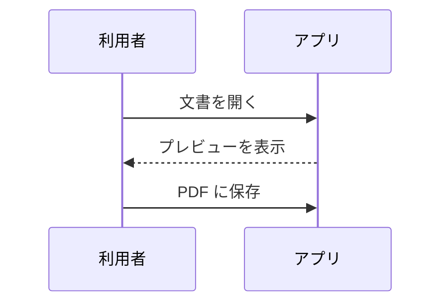

# 図とグラフ

## Mermaid の図



## Vega-Lite のグラフ

```vega-lite
{
  "$schema": "https://vega.github.io/schema/vega-lite/v5.json",
  "title": "月ごとの件数",
  "width": 360,
  "height": 160,
  "data": {"values": [
    {"月": "1月", "件数": 12}, {"月": "2月", "件数": 18},
    {"月": "3月", "件数": 9},  {"月": "4月", "件数": 24}
  ]},
  "mark": "bar",
  "encoding": {
    "x": {"field": "月", "type": "nominal", "sort": null},
    "y": {"field": "件数", "type": "quantitative"}
  }
}
```
